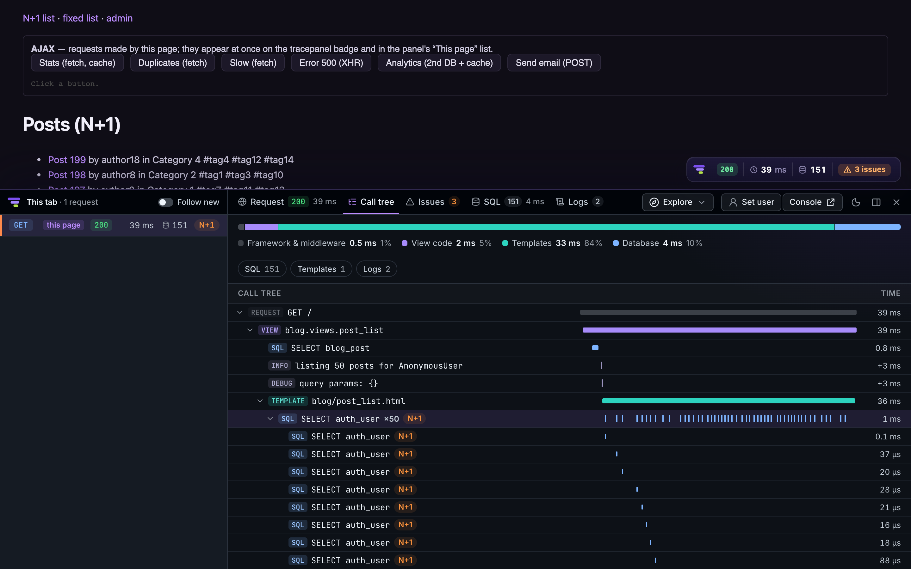
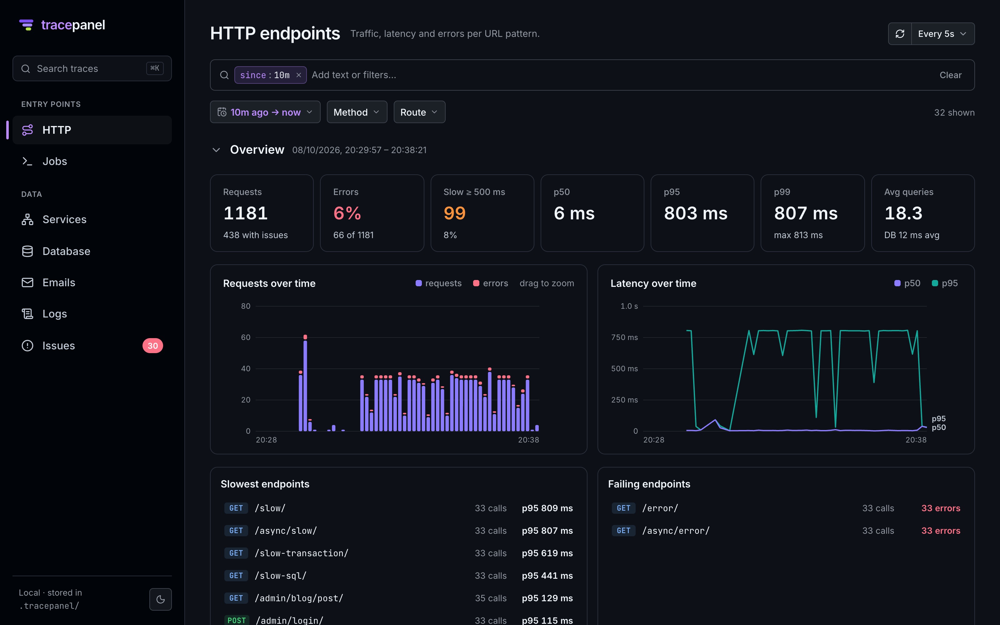

# tracepanel for Django

See what your Django app is really doing.

**Every request, query and task of your Django app, traced.** Each request your app serves becomes a trace: its
SQL, cache calls, templates, signals, emails, logs, the tasks it queues and the errors it raises, in the order they
happened. tracepanel reads the trace for you and points at what to fix: an N+1 with the `select_related()` that
removes it, duplicate queries, slow SQL, a transaction that holds its locks too long.

```bash
pip install django-tracepanel
```

```python
# settings.py
INSTALLED_APPS += ["tracepanel.django"]
```

That is the whole setup. With `DEBUG = True`, open any page of your app.



## What you get

**A panel on every page.** A badge in the corner shows the request's status, time, queries and issues; click it for
the panel, docked at the bottom or on the right like the browser's DevTools. It lists every request the page made,
`fetch()` calls included, and opens each one: its call tree, its SQL, its logs.

**A console at `/__tracepanel__/`.** Everything the app did, beyond one page: HTTP endpoints, GraphQL operations,
Celery and other tasks, management commands, WebSocket consumers, with charts over time and a search across all of
it.



**A line in the terminal** for work with no page to show it on: each task run and management command ends with a
summary and a link to its trace.

## How it differs from django-debug-toolbar

| | django-debug-toolbar | tracepanel |
| --- | --- | --- |
| What it sees | the HTML page you are on | every request, `fetch()`, API call, task and command |
| JSON APIs, SPAs | needs a page to attach to | the same panel, and headers any client can read |
| Tasks | — | Celery, RQ, Dramatiq and Django Tasks: each run traced and linked to the request that queued it |
| Findings | the raw queries | N+1, duplicates, slow SQL, long transactions, errors, each with the fix in Django's terms |
| History | the current request | a local store of recent traces, searchable |

Nothing leaves your machine: traces are kept in a SQLite file in your project (`.tracepanel/`), and the console is
served by your own app.
