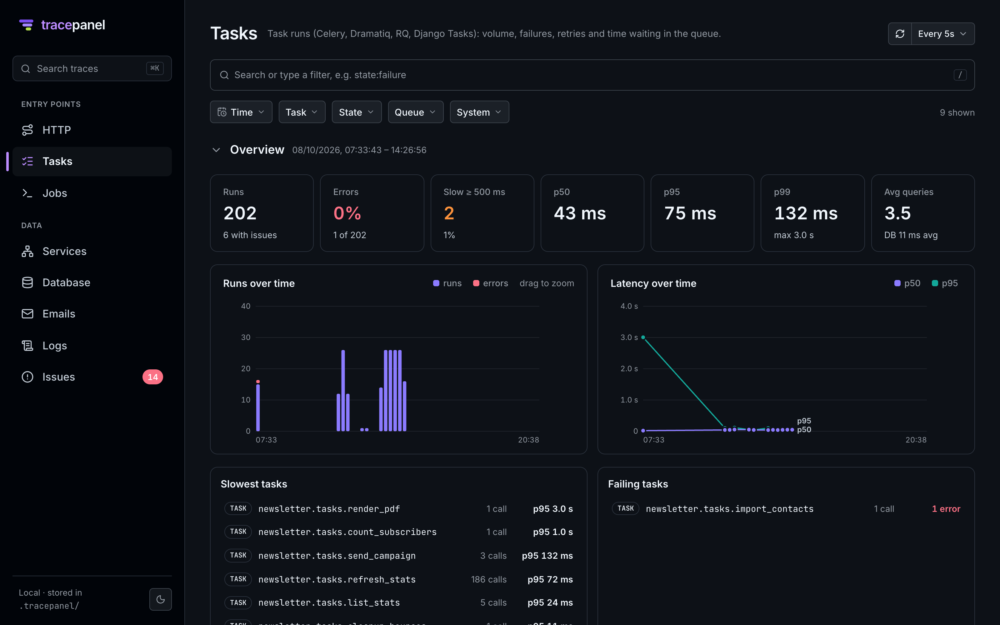

# Integrations

Django itself is covered out of the box: SQL (every connection, `async` ORM included), transactions and `on_commit()`,
the view, templates, the cache, signals, emails, management commands and `sync_to_async`. On top, tracepanel traces
the libraries it finds installed. Each one is on as soon as its library is there; turn one off with its setting
(`drf_enabled = False`, or `TRACEPANEL_DRF_ENABLED=false`). `tracepanel config` lists them and says which are on.

| Integration | Setting | What you get |
| --- | --- | --- |
| logging | `logging_enabled` | Log records of the request, attached to the span they were logged in. No handler is added: your logging setup is unchanged. |
| Django REST framework | `drf_enabled` | The view named after the ViewSet action (`PostViewSet.list`); auth, permissions (which class refused, and why), throttles, validation (the 400's errors) and serialization as steps. |
| Django Ninja | `ninja_enabled` | The view named after the operation's function; auth, input validation (the 422's errors) and response serialization as steps. |
| Celery | `celery_enabled` | Each task run as a trace, linked to the request that queued it; retries and failures; arguments and results. |
| RQ | `rq_enabled` | The same for RQ jobs, through RQ's forking worker. |
| Dramatiq | `dramatiq_enabled` | The same for Dramatiq actors. |
| Django Tasks | `django_tasks_enabled` | The same for `django.tasks` (and the `django-tasks` backport). |
| Channels | `channels_enabled` | WebSocket events as traces; group messages linked to their sender. |
| Strawberry | `strawberry_enabled` | GraphQL requests named after the operation; resolvers as spans; errors behind HTTP 200 recorded. |
| OpenTelemetry | `otel_enabled` | Spans from the OpenTelemetry instrumentations you enable (httpx, requests, redis, boto3, gRPC…) in the call tree, and the services they call on the Services map. See below. |

## OpenTelemetry

Libraries tracepanel has no integration for may have an OpenTelemetry instrumentation. Enable it as usual and its
spans show up in the request, task or job they ran in, under the span that was current:

```python
from opentelemetry import trace
from opentelemetry.instrumentation.httpx import HTTPXClientInstrumentor
from opentelemetry.sdk.trace import TracerProvider

trace.set_tracer_provider(TracerProvider())  # or your own, with its exporters; or `opentelemetry-instrument`
HTTPXClientInstrumentor().instrument()
```

tracepanel joins the `TracerProvider` the project sets (before or after Django starts) and never sets one itself,
so exporters configured for it keep working. Spans of what tracepanel records itself (Django, SQL, Celery, logging)
are left out, so nothing shows twice. It needs `opentelemetry-sdk`, which a project using OpenTelemetry has already.

## Tasks

A task queued during a request shows in the request's call tree, and its run is a trace of its own that links back
to it, so a slow page and the work it left behind read together.


 A worker started with `tracepanel run` (or with
`tracepanel.django` in `INSTALLED_APPS`) prints a line per task with a link to its trace.

```bash
tracepanel run celery -A config worker
```

## Settings changed at startup

Integrations are installed when the app starts. Changing an `*_enabled` setting needs a restart.
