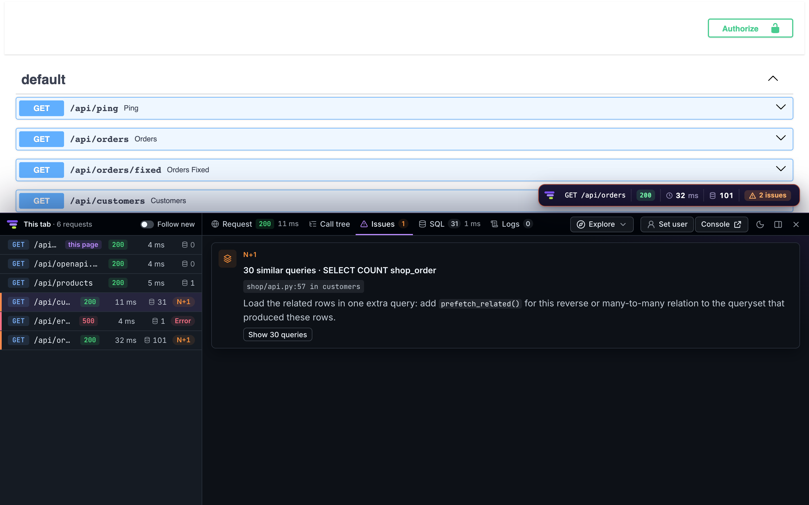
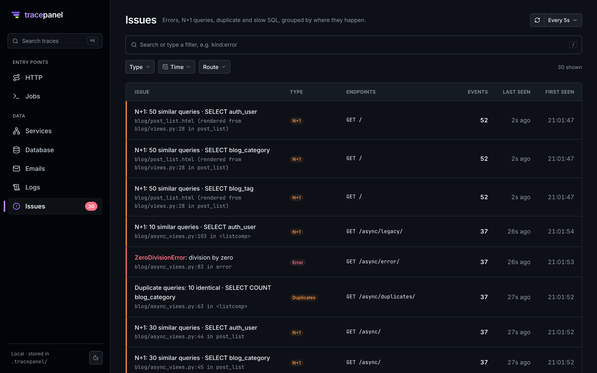

# What it finds

tracepanel reads every trace as it ends and reports what is worth fixing. Each issue names the line of your code it
comes from (the culprit) and says how to fix it in Django's terms. Issues show in the panel (the **Issues** tab and
the badge's count), on the console's **Issues** page grouped across requests, and in the terminal line of tasks and
commands.





## N+1 queries

The same query, run once per row of an earlier result:

```python
for post in Post.objects.all():
    print(post.author.name)  # one SELECT per post
```

tracepanel reports it when similar queries (the same statement with different parameters) run at least
`n_plus_one_threshold` times (3 by default) from the same place. The fix depends on the relation:

- a ForeignKey or one-to-one, looked up by its key: `select_related("author")`, one query with a join;
- a reverse or many-to-many relation: `prefetch_related("tags")`, one extra query for all rows.

An N+1 inside library code still counts when your view started it: a nested DRF serializer reading `author.username`
is reported against the view. In GraphQL resolvers, the hint suggests a DataLoader.

## Duplicate queries

The same query with the same parameters, run more than once in a request: run it once and reuse the result.

## Slow SQL

A query slower than `slow_sql_ms` (100 ms by default). **Explain** on the query shows the plan, and points at full
scans.

## Long transactions

An outer `atomic()` block that stays open longer than `long_transaction_ms` (500 ms by default). Rows it locked stay
locked until `COMMIT`; keep slow work (HTTP calls, emails, heavy Python) out of the block. `on_commit()` callbacks run
after the commit and are not counted.

## Work inside a transaction

Things that should wait for the commit:

| Inside `atomic()` | Why it matters | Fix |
| --- | --- | --- |
| Queueing a task | a worker can run it before `COMMIT` and not see the data, or after a rollback | `transaction.on_commit(lambda: task.delay(...))` |
| Sending an email | it goes out even if the transaction rolls back | `transaction.on_commit(...)` |
| An HTTP call | the transaction holds its locks while the other service answers | call before `atomic()`, or in `on_commit()` |

## Errors

Unhandled exceptions, with the stack (your frames first) and the local variables of your code. The same error from
the same place groups into one issue across requests, with a count.

## Tuning

The thresholds are settings: `n_plus_one_threshold`, `slow_sql_ms`, `long_transaction_ms`
([Configuration](configuration.md)).
