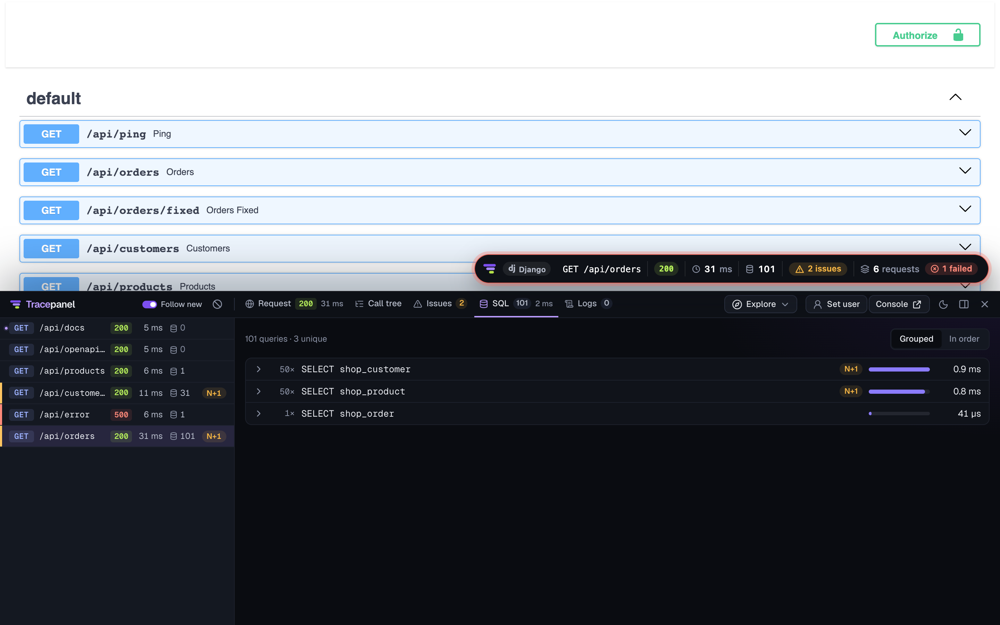
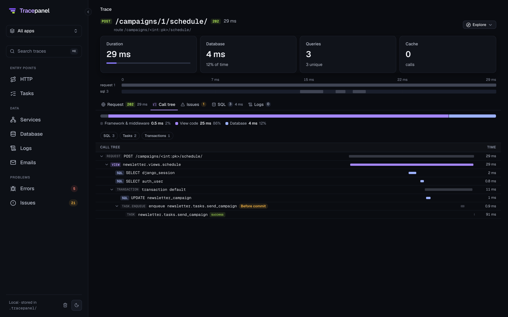
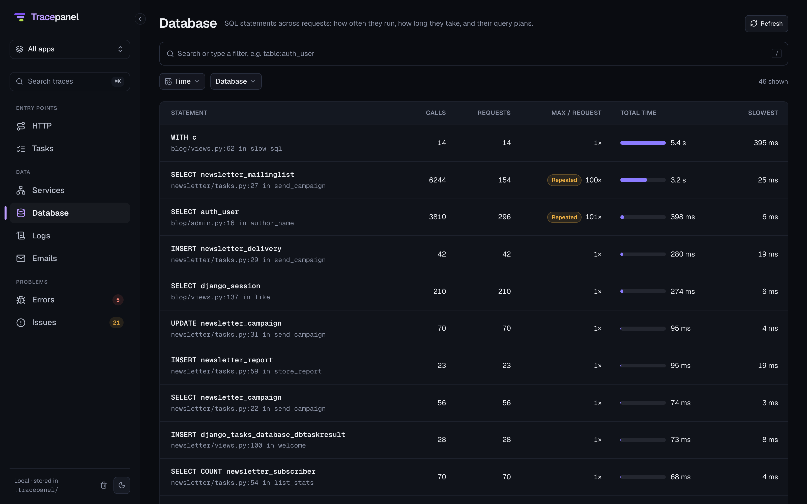
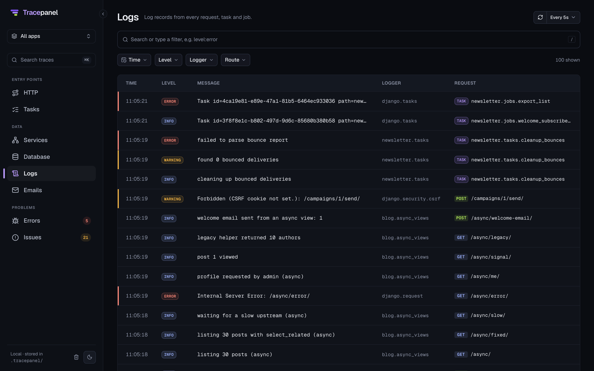

# The panel and the console

## The badge

Every traced response carries a few headers, and the badge on the page reads them: the status, the total time, the
number of queries and the number of issues. The badge appears on HTML pages; `fetch()` and XHR calls the page makes
are picked up too, so a single-page app shows its API calls the same way.

## The panel

Click the badge for the panel. It docks at the bottom of the page or on the right, and can be resized.

On the left, the requests of this page, newest last. **Follow new** keeps the newest one selected as they arrive.

On the right, the selected request, in tabs:

Request
:   The status and time on the tab itself. Inside: the URL, the route, the view, the user, every attribute of the
    trace.

Call tree
:   What the request did, in order: middleware, the view, SQL, cache calls, templates, signals, emails, queued
    tasks, logs. A bar on top splits the time between framework, your code and the database. Filters narrow the tree
    to one kind of span; similar queries fold into one row with a count.

Issues
:   What Tracepanel found in this request, with the fix ([What it finds](issues.md)).

SQL
:   Every query with its time and where in your code it came from. **Explain** runs `EXPLAIN` on the query and shows
    the plan.

Logs, Mail, Error
:   The request's log records, the emails it sent (text and HTML), and its error with the stack and local variables.

The panel opens on the tab you used last, except for a request with an error, which opens on **Error**.

**Explore** jumps from the request to related views in the console: the same endpoint over time, the same query
elsewhere. **Console** opens the trace there. The theme button switches light, dark and the system's.

### Switching the user

With `django.contrib.auth` and `django.contrib.sessions` installed and `DEBUG = True`, the panel can log you in as
another user: search by username, name or email, and the page reloads as that user. It works with custom user models.
Only requests from this machine (or `INTERNAL_IPS`) can switch, and only from the page itself.

## The console

`/__tracepanel__/` on your app, or the agent's own address (the terminal lines link to it, `tracepanel dev`: :8765).

**Entry points.** One page per kind of work, shown once there is data for it:

- **HTTP**: endpoints by route;
- **GraphQL**: operations by name;
- **Tasks**: Celery, Dramatiq, RQ and Django Tasks runs;
- **WebSockets**: Channels consumers;
- **Jobs**: management commands.

Each page starts with an overview (volume, errors, latency percentiles, the slowest and the failing groups; drag on a
chart to zoom into a time range), then the list: grouped (**By endpoint**, **By task**, …) or every call.

Every trace opens on a page of its own: the timeline, the time split, the call tree.

**Data.** Services (the databases, caches and outside services your app talks to), Database (queries across
requests), Emails, Logs and Issues.

### Search

The search box takes free text and filters. A few:

| Filter | Example |
| --- | --- |
| `status` | `status>=500` |
| `route` | `route:/api/*` |
| `duration` | `duration>500ms` |
| `queries` | `queries>20` |
| `task`, `state`, `queue` | `task:newsletter.* state:failure` |
| `user` | `user:42` |
| `since`, `until` | `since:1h` |

Type a key and the box suggests the rest; finish a filter with a space or Enter to turn it into a chip.
